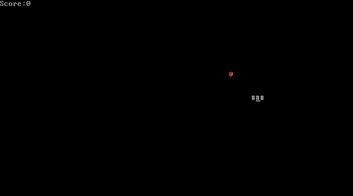

# snake_nasm

> A complete **Snake** game that fits in a **512-byte boot sector**, written in 16-bit x86 assembly (NASM).


<p align="center">
  
</p>

No operating system, no libraries: the BIOS loads the sector at `0x7C00` and the game starts right away. Rendering, keyboard input and timing are all handled through BIOS interrupts.

## Table of Contents

- [Features](#features)
- [Requirements](#requirements)
- [Build and Run](#build-and-run)
- [Controls](#controls)
- [Project Structure](#project-structure)
- [How It Works](#how-it-works)
- [Known Limitations](#known-limitations)
- [License](#license)

## Features

- Snake grows with every apple eaten
- Red apple placed at a random position (seeded from the BIOS clock)
- Score displayed in the top-left corner
- Collision detection with screen borders and the snake's own body
- *Game Over* screen with restart on <kbd>Enter</kbd>
- All of it in **506 bytes** of code and data, plus the `0xAA55` boot signature

## Requirements

| Tool | Purpose |
|------|---------|
| [NASM](https://www.nasm.us/) | Assembles the source into a flat binary |
| [QEMU](https://www.qemu.org/) (`qemu-system-i386`) | Emulates an x86 PC to boot the image |
| GNU Make | Automates the build |

Installation by platform:

```bash
# Arch Linux
sudo pacman -S nasm qemu-system-x86 make

# Debian / Ubuntu
sudo apt install nasm qemu-system-x86 make

# macOS (Homebrew)
brew install nasm qemu make
```

## Build and Run

```bash
git clone https://github.com/STERN3L/snake_nasm.git
cd snake_nasm
make run
```

Available targets:

| Command      | Description                                       |
|--------------|---------------------------------------------------|
| `make`       | Assembles `src/boot.asm` into `build/boot.img`    |
| `make run`   | Builds if needed, then boots the image in QEMU    |
| `make clean` | Removes the `build/` directory                    |

> **On real hardware:** the image can be written to a USB drive (`dd if=build/boot.img of=/dev/sdX bs=512 count=1`) and booted on a PC in BIOS/Legacy mode. ⚠️ This overwrites the first sector of the target device, so double-check the device name.

## Controls

| Key              | Action                    |
|------------------|---------------------------|
| <kbd>W</kbd>     | Up                        |
| <kbd>S</kbd>     | Down                      |
| <kbd>A</kbd>     | Left                      |
| <kbd>D</kbd>     | Right                     |
| <kbd>Enter</kbd> | Restart after Game Over   |

Keys are read as lowercase, so make sure Caps Lock is off. On an AZERTY keyboard, QEMU uses a QWERTY layout by default, so the physical keys are <kbd>Z</kbd> <kbd>Q</kbd> <kbd>S</kbd> <kbd>D</kbd>.

## Project Structure

```
snake_nasm/
├── src/
│   └── boot.asm        # Full game source (boot sector)
├── docs/
│   └── screenshot.png  # Screenshot used in this README
├── Makefile            # Build and run targets
├── LICENSE
└── README.md
```

The `build/` directory is generated by `make` and is not tracked.

## How It Works

The program runs in **16-bit real mode** and is loaded by the BIOS at address `0x7C00` (`[ORG 0x7C00]`).

**Initialization**
- `DS`, `ES` and `SS` are zeroed, and the stack is placed right below the code (`SP = 0x7C00`).
- The video mode is set to 80×25 color text through `int 0x10` (AX = `0x0003`).

**Game loop**

```
game_loop:
    clear screen → draw score → draw apple and snake
    → read keyboard → move snake → check collisions → wait
```

**Snake representation**
- Segments are stored in an array at `0x8000`, one word (2 bytes) per segment: low byte = column, high byte = row. This is exactly the format `DX` expects when setting the cursor position (`int 0x10`, AH = `0x02`).
- On every tick, the array is shifted by one slot and the head moves according to `dir_x` / `dir_y`.

**BIOS services used**

| Interrupt  | Service  | Used for |
|------------|----------|----------|
| `int 0x10` | Video    | Text mode, cursor positioning, screen clearing (scroll), character output |
| `int 0x16` | Keyboard | Non-blocking key check (AH = `0x01`), then reading the key |
| `int 0x1A` | Clock    | Pseudo-random apple position and frame delay (~2 ticks ≈ 110 ms) |

**Size constraint**: the image is padded to 510 bytes and ends with the `0xAA55` signature, which the BIOS requires to recognize it as bootable:

```nasm
times 510-($-$$) db 0
dw 0AA55h
```

## Known Limitations

- The snake can reverse into itself, which causes an immediate Game Over.
- Only lowercase `w` `a` `s` `d` are recognized (arrow keys are not supported).
- The apple can spawn on top of the snake's body.
- Game speed depends on the BIOS clock (18.2 Hz) and stays constant throughout the game.
- Only 4 bytes are left in the sector, so any new feature requires optimizing the existing code.

## License

Distributed under the MIT License. See [`LICENSE`](LICENSE) for details.
